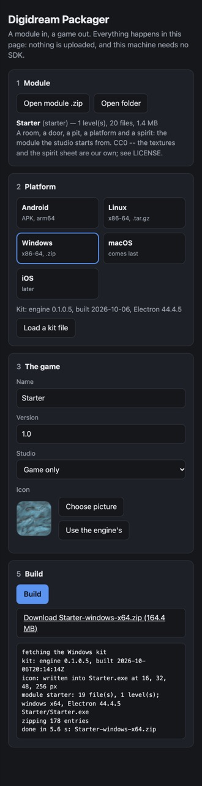

# Digidream Packager

A module in, a game out. Pick a game module, pick a platform, name the game,
and the Packager builds it: an Android APK, or a desktop app for Windows,
Linux or macOS. It all happens on your machine, in the page. Nothing is
uploaded, and you need no SDK, compiler, JDK or Docker. It runs on a phone too.

## Download

From the [latest release](https://github.com/projectdigidream/digidream-packager/releases/latest):

| platform | file | |
|---|---|---|
| Windows | `digidream-packager-<version>-windows-x64.zip` | unzip, run `Digidream Packager.exe` |
| macOS (Apple silicon) | `digidream-packager-<version>-macos-arm64.zip` | unzip, open the app |
| macOS (Intel) | `digidream-packager-<version>-macos-x64.zip` | |
| Linux | `digidream-packager-<version>-linux-x64.tar.gz` | unpack, run `./digidream-packager` |
| Android | `digidream-packager-<version>-android.apk` | sideload it |
| any browser | `digidream-packager-<version>-web.zip` | unzip, serve the folder (below) |

**macOS:** the app is signed ad hoc but not notarized, so the first time macOS
says it "could not verify" it. Open **System Settings > Privacy & Security**,
scroll to the message about the Packager and click **Open Anyway**.

**The web version** needs a local server, since browsers refuse to run it from
a file. Unzip it, then in that folder run `node serve.js` (or any static
server, such as `python3 -m http.server 8950 --bind 127.0.0.1`) and open
http://127.0.0.1:8950/. It needs a secure context: `127.0.0.1` or https.

## Do I need it?

If you make your game in **Digidream Studio**, probably not: the Studio's
**Package** page *is* the Packager, built in, working on the module you have
open. Use the standalone Packager when:

- the module was not made in the Studio (a folder you wrote by hand), or came
  to you as a zip;
- you want to build games on a machine, or a phone, without the Studio;
- you build the same game for several platforms and want the kits kept in one
  place.

## Use it

1. **Module.** *Open module .zip* (the Studio's Export, or any zip of a module
   folder) or *Open folder*.
2. **Platform.** Pick one. Each platform needs its **kit** (see below): if it
   is not there yet, the tile says so and a **Download the ... kit** button
   appears under the platforms. For the desktops you also choose the shell:
   Electron (the default, self-contained) or Tauri (small, uses the system's
   own web view).
3. **The game.** Its name, version, icon, and for Android the package id.
4. **Key** (Android). Made for you the first time and kept in this browser or
   app. **Back up key** and keep the file private: a later update of the game
   must be signed with the same key, or phones refuse it.
5. **Build.** The game is saved where you choose (desktop app), downloaded
   (browser), or on Android saved or installed directly.

What you get:

| platform | the game |
|---|---|
| Android | a signed APK, arm64 |
| Windows | `<Name>-windows-x64.zip`: unzip, run `<Name>.exe` |
| Linux | `<Name>-linux-x64.tar.gz`: unpack, run `./<id>` |
| macOS | `<Name>-macos-arm64.zip` or `-x64.zip`: `<Name>.app`, signed ad hoc (players see the same Open Anyway step) |

iOS is not supported yet.

## Kits: where they come from

A kit is the game engine, prebuilt for one platform. The Packager lays your
module beside it, renames and signs the result; that is how it can build a
game without any compiler. Kits come from the **engine's releases**: every
[engine release](https://github.com/projectdigidream/digidream-engine/releases)
carries the full set, as `digidream-engine-<version>-kit-<platform>.zip`.

- **The desktop apps** download a kit themselves when you press its button.
  They also ship with the small ones (Android and the Tauri kits), so Android
  games and Tauri desktop games build right away.
- **In a browser**, GitHub does not let a page read the file itself, so the
  button starts a normal download; then load the file with **Load a kit file**.
- Either way a kit is kept (in the app's or the browser's own storage) and is
  there for every later build, offline. The Electron desktop kits are big,
  130 to 170 MB each; the Android kit is 14 MB and the Tauri kits about 2 MB.

A kit says which engine version it carries (shown under the platforms once it
is loaded). The download button always offers the latest engine release's
kits; for an older one, download its kits from that release's page and load
them as files.

## Build from source

The page itself needs no build: `node serve.js` serves it at
http://127.0.0.1:8950/. Building the kits and the Packager apps needs the
engine checked out beside it; see [DEVELOPING.md](DEVELOPING.md).

## Licence

MIT, see [LICENSE](LICENSE).
